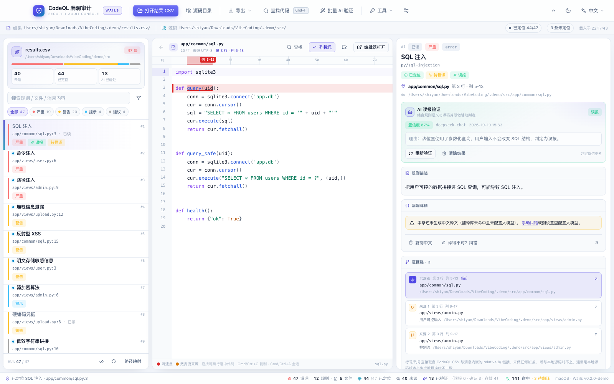
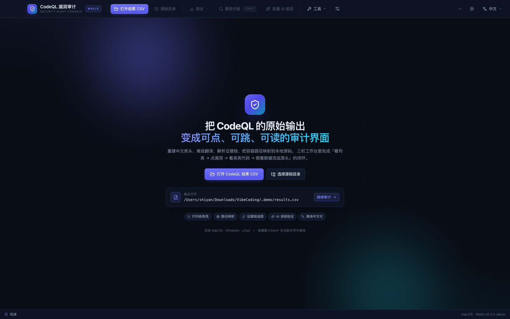
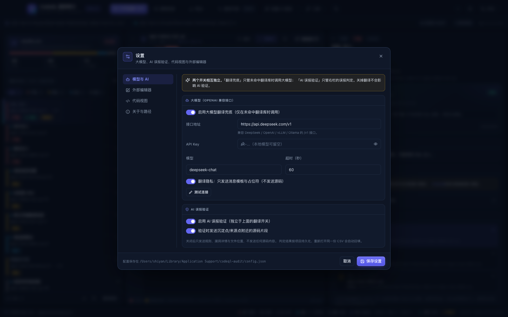
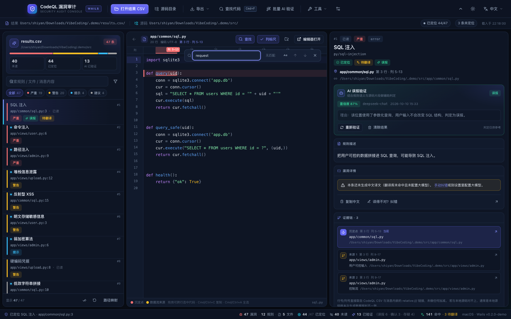
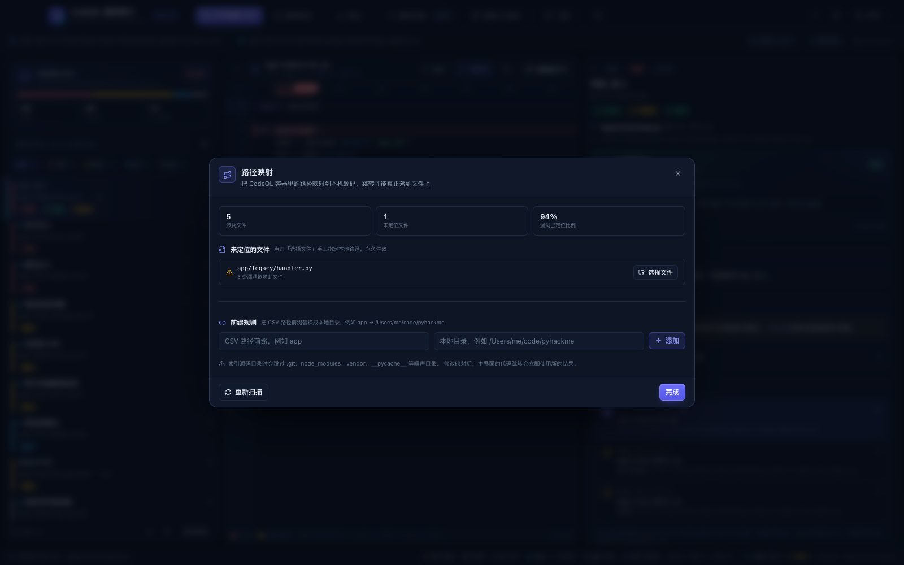
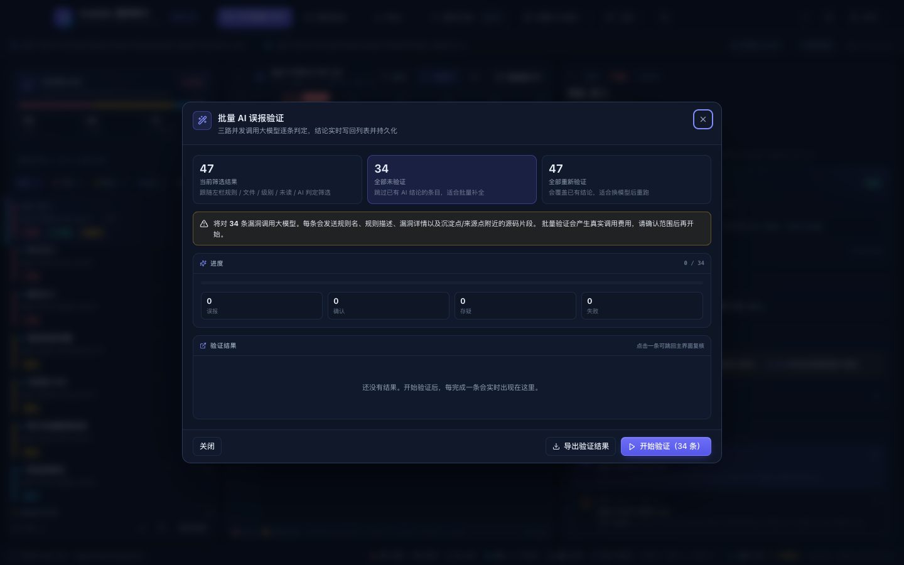

# CodeQL 漏洞审计工具（codeql-audit）

[](https://go.dev)
[](https://wails.io)
[](https://react.dev)
[](https://www.typescriptlang.org)
[](#31-环境要求)
[](#10-开源许可)


**把 `codeql database analyze --format=csv` 的原始输出，变成「可点、可跳、可读」的中文审计界面。**

界面采用 **Wails 2 + React 19 + TypeScript + CodeMirror 6**：Go 负责审计内核与原生能力，
前端负责三栏工作台、代码高亮、证据链、AI 误报验证与中文翻译。
原生窗口、系统文件选择框、剪贴板与外部编辑器调用由 Go 直接调用系统 API。


> 深色 / 浅色双主题，浅色主题见 [docs/screenshot-light.png](docs/screenshot-light.png)。

---

## 1. 它解决什么问题

`codeql database analyze --format=csv` 的输出固定 9 列、**没有表头**、内容**全英文**，而且：

1. 路径是构建环境/容器内的路径（如 `/app/views/user.py`），跟本机源码目录对不上；
2. 一条漏洞的详情里**内嵌了数据流来源位置**（`[["标签"|"relative:///path:line:col:line:col"]]`），信息量很大但没法点；
3. 一条记录可能对应**多个源码位置**（有的事务聚合了 3 处输入源）。

本工具把上面这些全部处理掉：重建表头、离线翻译、解析证据链、把路径映射到本地真实文件，
最后在一个三栏界面里完成「看列表 → 点漏洞 → 看高亮代码 → 顺着证据链追源头」的闭环。

---

## 2. 界面

| 深色主界面 | 浅色主题 |
|---|---|
|  |  |

| 启动页 | 设置 |
|---|---|
|  |  |

| 在当前文件中查找 | 路径映射 |
|---|---|
|  |  |

| 批量 AI 验证 |
|---|
|  |

### 2.1 界面总览

三栏布局：**左栏漏洞列表 / 中栏代码 / 右栏详情**，中间两条分隔条可拖动，
拖出来的宽度会写进配置，下次启动保持原样。

| 区域 | 内容 |
|---|---|
| 顶栏 | 打开结果 CSV、选择源码目录、导出（中文 CSV / 审计报告 / AI 验证结果）、查找代码、批量 AI 验证、工具（翻译库 / 路径映射 / 设置 / 打开数据目录）、主题切换、详情语言 |
| 项目条 | 结果文件路径、源码目录、已定位比例、未定位条数、解析提示、载入时间；可收起 |
| 左栏 | 项目摘要卡（未读 / 已定位 / AI 已验证）、搜索框、严重级别筛选、高级筛选（规则 / 文件 / AI 判定 / 只看未读 / 查看未定位）、虚拟滚动漏洞列表、全部标为已读 / 重置已读 / 路径映射入口 |
| 中栏 | 文件路径与编码、返回上一次跳转、列标尺开关、查找条、在文件管理器中显示、用编辑器打开、CodeMirror 只读代码视图（行列级高亮、跨行选中、右键菜单） |
| 右栏 | 规则名（中英）、严重级别徽章、定位/翻译状态、AI 误报验证卡、规则描述、中文详情（内联可点链接）、证据链、复制 / 纠错 / 编辑器打开、英文原文折叠 |
| 底栏 | 总数、规则数、文件数、已定位、未读、AI 已验证与结论分布、翻译命中、待翻译、平台与版本 |

### 2.2 交互与快捷键

| 操作 | 说明 |
|---|---|
| 点击左栏漏洞 | 中栏打开对应源码，沉淀点滚到视口中央，自动标为已读 |
| 点击右栏证据链 | 打开该来源点**自己所属的文件**并把该处居中高亮；跨文件来源点会正确切文件 |
| 返回上一次跳转 | 没有历史时按钮禁用；每次点击漏洞/证据链/详情链接都会产生一条历史 |
| `Cmd/Ctrl+F` | 在当前代码文件中查找；快捷键可在设置里改 |
| 查找条 | 边输入边高亮，显示「第 N / M 处」，上一处/下一处循环，回车下一处，Esc 关闭，可区分大小写 |
| 拖拽代码 | 跨行选中，`Cmd/Ctrl+C` 复制；`Cmd/Ctrl+A` 全选；右键「复制选中代码 / 复制当前行 / 全选代码 / 用编辑器打开」 |
| 列标尺 | 中栏标题栏勾选框与设置同步；每 10 列一个刻度，当前沉淀点/来源点画成色带并标注「列 26-28」 |
| 语言 | 右上角切换 中文 / 英文 / 中英对照，只影响右栏详情展示 |
| 主题 | 右上角太阳/月亮图标切换深色/浅色，选择保存在本地 |

---

## 3. 快速开始

### 3.1 环境要求

- Go 1.25+
- Node.js 20+ 与 pnpm 10+
- **Wails CLI 2.16+**：`go install github.com/wailsapp/wails/v2/cmd/wails@latest`
- macOS：Xcode Command Line Tools；Windows：WebView2 Runtime；Linux：WebKitGTK 与 gcc

先跑一遍环境自检：

```bash
wails doctor
```

### 3.2 安装依赖并启动开发模式

```bash
# 1. 安装前端依赖（Wails 也会自动执行）
cd frontend && pnpm install && cd ..

# 2. 热重载开发（同时启动 Vite 与原生窗口）
wails dev
```

`wails dev` 会启动 Vite 开发服务器并打开原生窗口；改 React 代码即时热更新，
改 Go 代码会自动重新编译。窗口内的前端也可以通过浏览器访问
<http://localhost:34115>（此时使用内置 mock 数据，不需要后端）。

### 3.3 打包

```bash
make build          # 等价于 wails build，产物在 build/bin/
make build-fast     # 跳过 pnpm install，只重建前端后打包
```

macOS 产物是 `build/bin/codeql-audit.app`，可直接双击运行。

### 3.4 三分钟上手

1. 点顶栏「**打开结果 CSV**」，选择 CodeQL 导出的结果文件；
2. 点「**源码目录**」，选择被审计的源码根目录（决定能否跳转；路径对不上时用「路径映射」补规则）；
3. 左栏点任意一条漏洞 → 中栏打开文件并居中高亮沉淀点，右栏显示中文详情与证据链；
4. 点右栏【来源 N】顺着数据流追源头；`Cmd/Ctrl+F` 在当前文件里查找；
5. 看完自动标为已读，勾「只看未读」继续；想省人力时用「AI 验证本条」或「批量 AI 验证」；
6. 收尾用「导出 → 审计报告」导出 28 列宽表，交给 Excel / pandas 二次分析。

### 3.5 命令行模式（批量 / 脚本）

不启动界面，直接解析 + 中文化 + 导出：

```bash
# 源码方式
go run . -cli -csv ../pyhackme.csv -src /path/to/src -out result_中文.csv

# 或 macOS 打包后的可执行文件
./build/bin/codeql-audit.app/Contents/MacOS/codeql-audit \
  -cli -csv ../pyhackme.csv -src /path/to/src -out result_中文.csv
```

实测输出：

```
漏洞总数　：47
规则种类　：7
涉及文件　：8
已定位源码：47/47
待翻译条目：0
翻译命中　：内置词典 141，翻译库 0，大模型 0
```

### 3.6 命令行参数

| 参数 | 说明 |
|---|---|
| `-csv <路径>` | CodeQL 结果 CSV 文件 |
| `-src <路径>` | 被审计的源码目录 |
| `-cli` | 命令行模式（不启动界面） |
| `-out <路径>` | 命令行模式下导出的中文 CSV |
| `-fonts` | 打印 WebView 中文字体说明 |
| `-version` | 版本信息 |

---

## 4. 功能详解

### 4.1 代码视图（CodeMirror 6）

- **行列级精确高亮**：沉淀点红色行背景 + 红色列高亮，数据流来源点黄色；当前聚焦项带脉冲动画；
- **行号与编码**：标题栏显示文件行数与探测到的编码（UTF-8 / UTF-16 / GBK / Big5）；
- **自动居中**：点击漏洞或证据链后，目标行滚到视口垂直正中央；
- **超长行**：横向滚动查看，高亮列不会错位；
- **查找**：独立高亮层，不覆盖漏洞行背景；命中数为当前文件全部匹配；
- **选中复制**：CodeMirror 原生选区，支持跨行、滚动、右键菜单、`Cmd/Ctrl+A`；
- **列标尺**：与代码使用同一等宽字体度量，列号取自 CSV 原始值；
- **未定位/越界提示**：行号超出文件总行数时给出明确提示，而不是静默跳过。

### 4.2 证据链

「证据链」里的每一行都显式写成「文件 · 第 N 行 · 列 A-B」，避免把列号误读成行号：

| 条目 | 取值来源 |
|---|---|
| 【沉淀点】 | CSV 第 5~9 列（文件、起始行、起始列、结束行、结束列） |
| 【来源 N】 | 漏洞详情内嵌的 `relative:///路径:起始行:起始列:结束行:结束列`，按出现顺序编号 |
| 标签 | 链接里的显示标签（经翻译库中文化） |
| 定位状态 | 已映射到本地文件 / 未定位（可点进路径映射处理） |

### 4.3 已读 / 未读与筛选

- 打开过的漏洞自动标为已读：列表变灰并标注「已读」，未读条目带蓝色圆点；
- 「只看未读」只列没看过的；「查看未定位」只列沉淀点还没定位成功的；
- 高级筛选支持规则、文件、严重级别、AI 判定（误报 / 确认 / 存疑 / 未验证）；
- 状态按项目（CSV 路径）持久化；漏洞指纹由「规则名 + 沉淀点文件/行列 + 原始消息」哈希而来，
  重新导出 CSV、改行序都不会丢已读状态。

### 4.4 AI 误报验证

右栏「AI 误报验证」卡：

- **单条验证**：把规则名、规则描述、严重级别、漏洞详情（中英）、沉淀点/来源点附近 ±3 行源码
  组织成提示词，要求模型只输出 JSON：
  `{"verdict":"false_positive|true_positive|uncertain","confidence":0.88,"reason":"…"}`；
- **结论展示**：绿「误报」/ 红「真实漏洞」/ 橙「存疑」，徽章与置信度、模型、时间分行显示；
- **批量验证**：顶部「批量 AI 验证」可按「当前筛选结果 / 全部未验证 / 全部重新验证」三档范围，
  3 路并发执行，实时显示进度与结论分布，可随时停止；
- **持久化**：结论按项目写回配置，下次打开同一份 CSV 自动回填；
- **隐私**：设置里可关闭「AI 验证时发送源码片段」，关闭后只发送规则、详情与位置；
- **独立开关**：AI 误报验证有自己的总开关，和翻译用的「大模型翻译兜底」互不影响。

### 4.5 翻译机制

翻译分四层，前两层完全离线：

```
待翻译文本
   │
   ├─ 1. 内置词典      规则名 / 规则描述 / 证据链标签 / 严重级别（人工精译）
   │                   ↓ 未命中
   ├─ 2. SQLite 翻译库  中英对照，越用越全；支持人工纠错回写
   │                   ↓ 未命中
   ├─ 3. 模板化翻译     把消息里的动态部分抽成占位符再翻译
   │                   ↓ 未命中
   └─ 4. 大模型兜底     OpenAI 兼容接口，结果落库后长期离线可用
```

- 规则名、描述、证据链标签、严重级别都中文化；
- 译文来源（内置词典 / 翻译库 / 大模型 / 未翻译）显示在右栏；
- 「译得不对？纠错」会写入 SQLite 翻译库并立即重译当前条；
- 工具 →「翻译库」可搜索、按类别浏览、直接编辑译文。

### 4.6 路径映射

CSV 里的路径来自 CodeQL 数据库的构建环境，工具用五级策略定位到本机文件：

| 优先级 | 策略 | 说明 |
|---|---|---|
| ① | 人工指定 | 在「路径映射」里为某个 CSV 路径手工选取本地文件，永久生效 |
| ② | 前缀规则 | 把 `/app` 替换成本地目录，例如 `app → /Users/me/code/pyhackme` |
| ③ | 直接拼接 | 源码目录 + CSV 路径，命中即用 |
| ④ | 后缀匹配 | 逐级去掉前导目录再匹配，适配「容器里 `/app` 就是源码根」 |
| ⑤ | 同名文件 | 按文件名兜底，有多个候选时降低置信度 |

- 映射工作台会列出所有**未定位**的文件与依赖条数，点「选择文件」即可补映射；
- 修改映射后主界面立即重新定位并刷新代码跳转；
- 索引源码目录时跳过 `.git`、`node_modules`、`vendor`、`__pycache__` 等噪声目录。

### 4.7 三种导出

| 入口 | 内容 | 适用场景 |
|---|---|---|
| 导出 → 中文 CSV | 中文重排后的 CodeQL 九列（中文表头） | 交付、回填 CodeQL、和原始 CSV 对照 |
| 导出 → 审计报告 | 一行 = 一条漏洞的**全部**审计信息（28 列） | 离线用 Excel / pandas 做二次分析 |
| 导出 → AI 验证结果 CSV | 只有做过 AI 判定的条目：序号/规则/文件/行列/判定/置信度/理由/模型/时间 | 汇报误报判定结论 |

三种导出都带 **UTF-8 BOM**，Excel 双击打开中文不乱码。

---

## 5. 配置文件与数据位置

| 平台 | 默认目录 |
|---|---|
| macOS | `~/Library/Application Support/codeql-audit/` |
| Windows | `%AppData%\codeql-audit\` |
| Linux | `~/.config/codeql-audit/` |

里面有两个文件：

- `config.json` —— 大模型设置、AI 验证隐私开关、编辑器设置、最近项目、路径前缀规则、
  人工映射、三栏间距、顶栏折叠、列标尺、查找快捷键，以及按项目保存的已读标记与 AI 判定；
- `translations.db` —— SQLite 翻译库（中英对照）。

关键字段：

```jsonc
{
  "llm": { "enabled": true, "base_url": "https://api.deepseek.com/v1", "model": "deepseek-chat" },
  "editor": { "cmd": "/usr/local/bin/code", "args": "-g {file}:{line}:{col}" },
  "ai_verify_enabled": true,
  "ai_verify_send_code": true,
  "display_lang": "zh",
  "top_info_collapsed": false,
  "show_column_ruler": true,
  "code_search_shortcut": "Cmd+F",
  "split_left": 0.24,
  "split_detail": 0.50,
  "projects": [{
    "csv_path": "…/pyhackme.csv",
    "src_root": "…/pyhackme",
    "reviewed": { "<漏洞指纹>": true },
    "verdicts": { "<漏洞指纹>": { "status": "false_positive", "reason": "…", "confidence": 0.88,
                                 "model": "deepseek-chat", "at": "2026-10-10T11:30:00+08:00" } }
  }]
}
```

**便携模式**：设置环境变量后，配置与翻译库都会放到指定目录，可以整个目录拷走：

```bash
CODEQL_AUDIT_HOME=/path/to/portable ./build/bin/codeql-audit.app/Contents/MacOS/codeql-audit
```

---

## 6. 项目结构

```
codeql-audit/
├── main.go                  Wails 入口：原生窗口、前端资产嵌入、文件拖放
├── app.go                   后端服务：生命周期、项目载入、源码/已读/映射、设置、编辑器
├── app_dto.go               暴露给前端的 DTO 与转换函数
├── app_ai.go                AI 误报验证、批量验证、翻译库/纠错
├── app_export.go            中文 CSV / 审计报告 / AI 验证结果导出
├── cli.go                   命令行模式
├── wails.json               Wails 构建配置
├── Makefile                 dev / build / test / typecheck
├── build/
│   ├── appicon.png          应用图标
│   └── darwin/Info.plist    macOS 包信息
├── frontend/                React 19 + TypeScript + Vite + Tailwind
│   ├── src/
│   │   ├── App.tsx          应用状态与三栏编排
│   │   ├── components/      TopBar / Sidebar / CodePanel / CodeView / DetailPanel / 弹窗
│   │   ├── lib/             api.ts（Wails 桥接）、events、格式化
│   │   ├── dev/mock.ts      浏览器开发模式 mock 后端
│   │   └── index.css        设计令牌、深浅主题、代码高亮样式
│   └── wailsjs/             Wails 生成的绑定（构建时自动生成）
├── internal/
│   ├── model/               核心数据结构
│   ├── codeqlcsv/           CSV 解析、链接提取、中文表头、审计报告
│   ├── translate/           词典 / 模板 / SQLite / 大模型翻译
│   ├── verify/              AI 判定提示词与 JSON 容错解析
│   ├── pathmap/             五级路径映射
│   ├── sourcefile/          源码读取与编码探测
│   ├── config/              配置与项目状态持久化
│   ├── project/             编排层：解析 → 翻译 → 定位 → 统计 → 筛选 → 导出
│   └── editor/              外部编辑器探测与启动
└── docs/                    界面截图
```

### 6.1 前后端边界

前端不直接碰 Go 内部结构，只通过 `App` 暴露的 DTO 通信：

- `Bootstrap()`：设置、最近项目、平台、版本、默认快捷键；
- `LoadProject(csv, src)`：解析 + 翻译 + 定位，返回 `ProjectDTO`（findings、stats、筛选选项、未定位清单）；
- `GetSourceFile(csvPath, resolvedPath)`：按需读取源码并返回行数组与编码；
- `SetReviewed` / `ResetReviewed`、`VerifyFinding` / `StartBatchVerify`、`Export*`、
  `GetMapping` / `AddPrefixRule` / `ChooseOverrideFile`、`SaveSettings` / `SaveUIPreferences` 等。

耗时操作通过事件汇报：

- `project:progress`：载入项目的阶段与进度；
- `batch:progress` / `batch:done`：批量 AI 验证的实时结果与汇总；
- `file:dropped`：拖入 CSV 或源码目录。

前端通过 `window.go.main.App.*` 调用绑定方法，通过 `window.runtime.EventsOn` 订阅事件；
在浏览器开发模式下，`src/lib/api.ts` 会自动切换到 `src/dev/mock.ts`，因此不需要 Wails 也能调 UI。

### 6.2 技术选型

- **排版能力**：CSS 的网格/弹性布局、滚动、文本换行、主题与动效，适合做三栏审计台；
- **代码视图**：CodeMirror 6 天生支持大文件、选区、查找、语法高亮与装饰器，行列高亮更稳；
- **设计一致性**：设计令牌统一管理颜色、间距、圆角、阴影，深色/浅色主题切换只改一组变量；
- **可调试性**：界面可以在浏览器里用 mock 数据开发与截图，前后端边界清晰；
- **原生能力保留**：文件选择框、剪贴板、外部编辑器、窗口尺寸与关闭保存仍由 Go 调用系统 API。

项目只维护这一套 Wails 界面：开发模式与打包产物共用 `frontend/` 下的同一份代码。

---

## 7. 开发与测试

```bash
# 前端类型检查 + 构建
cd frontend && pnpm typecheck && pnpm build

# Go 测试（翻译引擎、AI 判定解析、外部编辑器、DTO 转换与导出）
make test

# 只跑 internal/* 包
make test-core

# 格式 / 静态检查
make fmt
make vet
```

### 7.1 浏览器里调 UI（无需 Wails）

```bash
cd frontend
pnpm dev
# 打开 http://localhost:34115
```

浏览器模式会自动使用 `src/dev/mock.ts` 的 47 条演示数据，并支持一些预览参数：

| 参数 | 效果 |
|---|---|
| `?theme=light` / `?theme=dark` | 强制主题 |
| `?empty=1` | 不自动载入项目，查看启动页 |
| `?modal=settings` | 直接打开设置 |
| `?modal=mapping` / `?modal=library` / `?modal=batch` | 直接打开对应弹窗 |

### 7.2 常见构建问题

- **macOS 15+ 链接报 `_OBJC_CLASS_$_UTType`**：升级到 Wails 2.16+（`wails` CLI 与 `go.mod` 保持一致）。
  如果坚持使用旧版，需要 `export CGO_LDFLAGS="-framework UniformTypeIdentifiers"`。
- **pnpm 报 `ERR_PNPM_IGNORED_BUILDS: esbuild`**：`frontend/pnpm-workspace.yaml` 已声明
  `allowBuilds: { esbuild: true }`；如果仍然报错，执行 `cd frontend && pnpm approve-builds`。
- **`wails dev` 能打开窗口但页面空白**：确认 `frontend/dist` 已构建，或先执行
  `cd frontend && pnpm build`；查看 `wails doctor` 的 Node/pnpm 路径。
- **中文显示**：Wails 使用系统 WebView 渲染，macOS 的苹方、Windows 的微软雅黑由系统负责；
  需要调整字体栈时修改 `frontend/src/index.css` 的 `--font-sans` / `--font-mono`。

---

## 8. 已知限制与路线图

### 8.1 已知限制

1. **只读浏览**：不提供代码编辑，改动请用「编辑器打开」回到惯用编辑器；
2. **只支持 CodeQL CSV 格式**（固定 9 列）；SARIF 输入（含完整 `codeFlows`）在路线图中；
3. **大模型翻译不并行**：命中翻译库时不联网；批量 AI 验证固定 3 路并发；
4. **AI 判定是辅助结论**：模型可能判断错误，界面始终标注「最终结论仍需人工确认」；
5. **列标尺只标注当前聚焦行**：手动滚动到别的行时不会跟着重算刻度；
6. **代码查找为纯文本匹配**：默认不区分大小写，支持切换；不是正则搜索。

### 8.2 后续计划

- SARIF 直接输入，展示完整 `codeFlows` 数据流链；
- 漏洞状态管理（已确认 / 误报 / 已修复 / 已修复待验证）与 Word/Excel 版审计报告；
- 两次审计结果 diff，看新增/修复了哪些漏洞；
- 每条规则附带修复建议与参考链接；
- 规则级仪表盘与趋势图。

---

## 9. 参与贡献

欢迎 Issue 和 PR。建议先读「[项目结构](#6-项目结构)」与「[前后端边界](#61-前后端边界)」。

- **环境**：Go 1.25+、Node 20+、pnpm 10+、Wails CLI 2.16+；
- **提交前**：`gofmt -l .` 无输出、`go vet ./...` 通过、`cd frontend && pnpm typecheck` 通过；
- **界面改动**：请在浏览器 mock 模式下附改动前后的截图（`?theme=dark` 与 `?theme=light`）；
- **加功能请顺手补测试**：Go 测试与实现同包（`internal/*/`），前端改动至少跑通 `pnpm build`；
- **报 Bug 请附**：操作系统与版本、`wails doctor` 输出、复现步骤；字体问题附 `-fonts` 输出。

---

## 10. 开源许可

本项目以 **GNU General Public License v3.0（GPL-3.0）** 开源：

- 可以自由使用、修改、分发，包括用于商业用途；
- 分发修改版或衍生作品时，必须同样以 **GPL-3.0** 开源并提供完整源码；
- 软件按「现状」提供，不附带任何形式的担保。

完整条款见 <https://www.gnu.org/licenses/gpl-3.0.html>；
如何理解这份许可见 <https://www.gnu.org/licenses/quick-guide-gplv3.html>。
