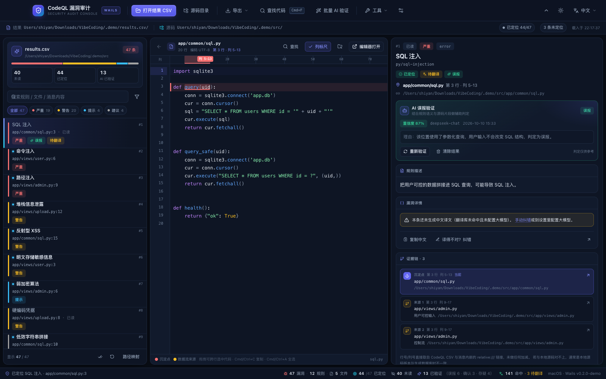
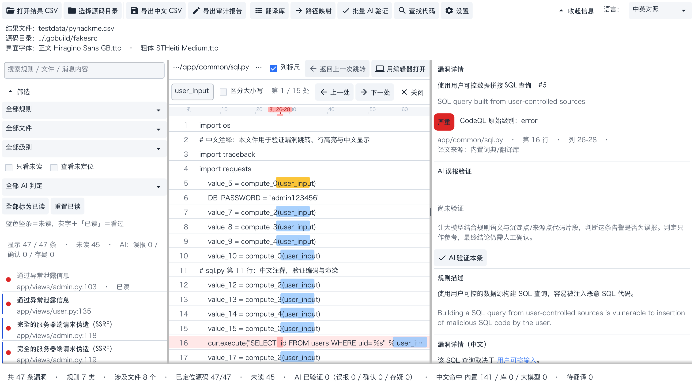

# CodeQL 漏洞审计工具（codeql-audit）

[](https://go.dev)
[](https://fyne.io)
[](#31-环境要求)
[](#17-开源许可)


**把 `codeql database analyze --format=csv` 的原始输出，变成「可点、可跳、可读」的中文审计界面。**

CodeQL 导出的 CSV 固定 9 列、没有表头、内容全英文，路径还是构建容器里的路径，一条漏洞的详情里
又内嵌着数据流来源位置 —— 这个工具把这些全部处理掉：重建中文表头、离线翻译、解析证据链、
把路径映射到本地真实文件，最后在一个三栏界面里完成「看列表 → 点漏洞 → 看高亮代码 → 顺着证据链追源头」的闭环。



## 核心特性

- **点击漏洞即可跳转并高亮源码** —— 行列级精确高亮，沉淀点红色、数据流来源点黄色，**高亮行自动滚到视口正中间**
- **列标尺定位** —— 代码上方直接标出「第几列」：每 10 列一个刻度，当前沉淀点/来源点的列范围带色带与「列 26-28」标识，整条只有 20px 高（可在设置里关闭，关掉后高度立刻还给代码）
- **已读 / 未读标记** —— 看过的漏洞会变灰并标注「已读」，未读的带蓝色竖条，可「只看未读」；旁边的「**查看未定位**」可以把还没映射到本地源码的条目单独挑出来
- **文字可以用鼠标复制** —— 代码视图里直接拖拽，**可以跨行选中一整段代码**（`Cmd/Ctrl+C` 或右键菜单）；选区不随滚动/刷新消失，`Cmd/Ctrl+A` 全选整个文件。右栏详情里的说明文字同样可以选中；带内联链接的中文详情用右键「复制本段文字」
- **AI 误报验证** —— 单条或批量让大模型结合源码片段判断「是否误报」，结论落盘、列表里一眼可见
- **AI 判定筛选** —— 左栏下拉可按「AI 误报 / AI 确认 / AI 存疑 / 未验证」单独挑出来复核
- **结果全中文化** —— 规则名、规则描述、漏洞详情、证据链标签、严重级别
- **自动补字段头** —— CodeQL 导出的 CSV 本身没有表头，工具会重建中文表头并可再导出
- **审计报告导出** —— 一条漏洞一行的宽表（28 列）：原始行列 + 中文翻译 + 本地路径 + 证据链 + 已读状态 + AI 结论，便于离线分析
- **本地翻译库（SQLite）** —— 中英对照沉淀下来，换个 CSV 继续复用
- **大模型兜底（可选）** —— 翻译库里没有的才调用，结果落库后长期离线可用
- **可配置外部编辑器** —— 设置里填编辑器路径与参数模板，一键在 VS Code / Cursor / Sublime 里打开对应行列

## 目录

1. [它解决什么问题](#1-它解决什么问题)
2. [功能详解](#2-功能详解)
3. [快速开始](#3-快速开始)
4. [翻译机制](#4-翻译机制)
5. [AI 误报验证](#5-ai-误报验证)
6. [路径映射](#6-路径映射)
7. [三种 CSV 导出](#7-三种-csv-导出)
8. [配置文件与数据位置](#8-配置文件与数据位置)
9. [中文字体](#9-中文字体)
10. [打包发布](#10-打包发布)
11. [项目结构](#11-项目结构)
12. [实现要点与设计取舍](#12-实现要点与设计取舍)
13. [测试](#13-测试)
14. [常见问题 FAQ](#14-常见问题-faq)
15. [已知限制与路线图](#15-已知限制与路线图)
16. [参与贡献](#16-参与贡献)
17. [开源许可](#17-开源许可)

---

## 1. 它解决什么问题

`codeql database analyze --format=csv` 的输出固定 9 列、**没有表头**、内容**全英文**，而且：

1. 路径是构建环境/容器内的路径（如 `/app/views/user.py`），跟本机源码目录对不上；
2. 一条漏洞的详情里**内嵌了数据流来源位置**（`[["标签"|"relative:///path:line:col:line:col"]]`），信息量很大但没法点；
3. 一条记录可能对应**多个源码位置**（有的事务聚合了 3 处输入源）。

本工具把上面这些全部处理掉：重建表头、翻译成中文、解析证据链、把路径映射到本地真实文件，最后在一个三栏界面里完成「看列表 → 点漏洞 → 看高亮代码 → 顺着证据链追源头」的闭环。

---

## 2. 功能详解

### 2.1 界面总览

三栏布局：**左栏漏洞列表 / 中栏代码 / 右栏详情**，中间分隔条可拖动。

- 两条分隔条都能自由拖动：右栏最窄可以收到 260px，最宽可以顶到「窗口宽 - 中栏最小宽」，
  拖出来的间距会记进配置，**下次打开还是这个宽度**（想恢复默认就删掉 `split_left` / `split_detail`）
- 界面配色做过对比度优化：正文接近纯黑、次要文字（文件名、行号、统计、译文来源、操作提示）
  是可读的中灰，不再是 Fyne 默认那种白底上几乎看不见的 `#E3E3E3`

| 区域 | 内容 |
|---|---|
| 顶栏 | 打开结果 CSV、选择源码目录、导出中文 CSV、**导出审计报告**、翻译库、路径映射、批量 AI 验证、**查找代码**、设置、**收起/展开项目信息**、语言切换（中文/英文/中英对照） |
| 左栏 | 搜索框、筛选（规则/文件/严重级别/只看未读/**查看未定位**/**AI 判定下拉**/全部标为已读/重置已读）、漏洞列表（未读竖条 + 严重级别色点 + 中文规则名 + 文件:行号 + AI 判定徽章） |
| 中栏 | 文件名与行号、**列标尺**与「列标尺」快捷勾选框、返回上一次跳转、用编辑器打开、**查找条（Cmd/Ctrl+F，命中高亮 + 上一处/下一处）**、带高亮的只读代码视图（**可拖拽跨行选中代码**，`Cmd/Ctrl+C` / `Cmd/Ctrl+A` / 右键「复制选中代码 · 复制当前行 · 全选代码」）；跳转提示只在「未定位 / 返回失败」这类需要处理时才展开成第二行 |
| 右栏 | 规则名（中英）、严重级别徽章 + CodeQL 原始级别、**AI 误报验证**（彩色结论徽章 + 置信度/模型/时间）、规则描述、中文详情（内联可点链接，可右键复制）、证据链、译文纠错、复制中文、英文原文（说明文字均可选中复制） |
| 底栏 | 统计：总数、规则数、文件数、已定位比例、未读数、AI 已验证数与结论分布、翻译命中来源、待翻译数 |

### 2.2 操作要点

- 点击右栏「**证据链**」里的沉淀点或来源点，中栏会打开**该位置自己所属的文件**并把该处高亮
  （跨文件的来源点也会正确切文件，不会把行号套到沉淀点所在文件上）；当前聚焦的那一项会带 ▶ 标记
- 「**返回上一次跳转**」按钮在没有历史记录时是**灰色禁用**状态，不会点了没反应；
  普通跳转不再在标题栏多写一行（跳到哪一行看居中的高亮即可），只有「未定位」「返回失败」这类
  需要用户处理的提示才会把标题栏撑成两行
- 右栏详情里的**蓝色链接**可以直接点击跳转
- 「**用编辑器打开**」按「设置 → 用编辑器打开」里的配置调用（默认 `-g {file}:{line}:{col}`，自动探测常见编辑器）
- 「**译得不对？纠错**」保存后立即生效，并写入翻译库

### 2.3 高亮与跳转定位

- **红色行背景 + 红色列高亮**：漏洞沉淀点（CSV 第 5~9 列给出的位置）
- **黄色行背景 + 黄色列高亮**：数据流来源点（从消息内嵌链接解析出来）
- 点击列表或证据链后，目标行会被滚动到**视口垂直正中间**（文件末尾会自动补白，保证最后几行也能居中）
- 漏洞位置在超长行的很右侧时，该行会自动横向裁剪并把高亮列带到可视区域
- 目标行的行号超出本地文件总行数时，代码视图顶部会给出「⚠ 行号越界」提示（通常意味着本地源码版本与生成数据库时不一致）

### 2.4 证据链的行号从哪来

「证据链」里的每一行都显式写成「文件 · 第 N 行 · 列 A-B」，避免把列号误读成行号：

| 条目 | 取值来源 | 说明 |
|---|---|---|
| 【沉淀点】 | CSV 第 5~9 列（文件、起始行、起始列、结束行、结束列） | 与 CSV 逐字对应，不做任何加减 |
| 【来源 N】 | 漏洞详情里内嵌的 `relative:///路径:起始行:起始列:结束行:结束列` | 按链接在消息中出现的顺序编号；一条记录可能有多处来源 |
| 标签 | 链接里的显示标签（经翻译库中文化） | 例如「用户可控输入」 |

`internal/ui/navigation_test.go` 里有一条测试会**直接读原始 CSV**，把 47 条记录的沉淀点四列与
每一条内嵌链接的行列号逐条比对，解析层一旦引入偏差就会失败。

> 如果行号与本地源码对不上，绝大多数情况是**本地源码版本与生成 CodeQL 数据库时不一致**，
> 而不是工具算错：跳转后代码视图顶部会提示行号是否越界，右栏也会标出「未定位」。

### 2.5 列标尺（第几列定位标识）

右栏证据链写着「第 16 行 · 列 26-28」，但中栏代码只有行号，肉眼很难数到第 26 列。
列标尺把列号画在代码正上方，整条只有 **20px**（约等于一行代码的行距，旧版是 34px）：

- 每 10 列一根刻度线并标出列号，最左侧的「列」字与行号栏对齐；
- 当前聚焦的沉淀点/来源点列范围画成色带（红色=沉淀点、黄色=来源），
  正上方贴着同色小色块「列 26-28」，并用一根竖线连到色带中心
  —— **列号取自 CSV 原值，与右栏证据链逐字一致**；
- 标尺与代码使用同一套字体度量（`fyne.MeasureText` + 代码字体），因此中英文混排也不会错位；
- 漏洞在超长行很右侧时，标尺会跟着代码一起横向裁剪，并用被裁掉的偏移量把列号还原成原值。

可在「设置 → 代码视图 → 显示列标尺」里关闭（配置项 `show_column_ruler`），
也可以直接点中栏标题栏上的「**列标尺**」勾选框 —— 两处入口共用同一份状态，改哪边都立刻生效。
关闭时工具会主动让「标尺 + 代码列表」重新布局，这份高度**立刻**还给代码，
不会在代码上方留下一条什么都不画的空白。

### 2.6 在当前代码文件中查找（Cmd/Ctrl+F）

中栏代码区支持「在**当前这个文件**里找内容」：按 `Cmd+F`（macOS）/ `Ctrl+F`（Windows/Linux），
或者点顶栏的「**查找代码**」按钮 / 菜单「**编辑 → 在当前文件中查找**」，代码上方会弹出查找条。



| 元素 | 说明 |
|---|---|
| 输入框 | 边打字边高亮，无需回车确认；提示文字里写着当前生效的快捷键 |
| 「第 N / M 处」 | 当前命中序号与总命中数；查不到时显示「无匹配」 |
| 上一处 / 下一处 | 循环跳转（在第一处按「上一处」会绕到最后一处），命中行会被滚动到**视口正中央** |
| 回车 | 跳到下一处（与「下一处」按钮等价） |
| 区分大小写 | 默认**不区分**；勾上后严格按大小写匹配 |
| Esc / 关闭 | 收起查找条并清掉查找高亮，沉淀点/来源点高亮不受影响 |

高亮配色：**浅蓝**＝命中，**琥珀**＝当前命中。两层都是半透明的，因此命中正好落在沉淀点（红）
或来源点（黄）上时，两层信息都还看得见（行背景色永远留给漏洞本身）。
换文件（例如点证据链跳到别的来源点）后会**用同一个查找词在新文件里重新查找**，
命中数也会跟着更新。

**快捷键可以改**：设置 → 代码视图 → **查找快捷键**。格式是「修饰键 + 主键」，
大小写与顺序都不敏感：

| 写法 | 说明 |
|---|---|
| `Cmd+F` | macOS 的 Command；默认值 |
| `Ctrl+F` | Windows/Linux 的默认值 |
| `Ctrl+Shift+G` | 多修饰键组合 |
| `Alt+F3` | 功能键 F1-F12 |
| `Ctrl+/` | 符号键，也支持 `SLASH`、`MINUS`、`EQUAL`、`PERIOD`、`COMMA`、`SEMICOLON`、`LEFTBRACKET`、`RIGHTBRACKET`、`SPACE` 等英文别名 |

留空或点「恢复默认」即回到平台默认键位；写法不合法时保存会给出具体错误并**保留原来的键位**，
不会把坏值写进配置。改完立即生效（旧的键位会被注销，不会两个键同时可用），并写入配置项
`code_search_shortcut`。

> 为什么这条快捷键同时挂在**画布**和「**编辑**」菜单上：Fyne 的按键分发顺序是
> 「主菜单快捷键 → 当前聚焦对象 → 画布快捷键」，而代码视图本身就是一个 `Shortcutable`
> 控件（它要靠这个身份接住 `Cmd/Ctrl+C` 复制代码），用户点过代码之后焦点就落在它身上，
> `Cmd/Ctrl+F` 会被它直接吃掉。主菜单快捷键在聚焦对象之前处理，所以「点过代码再按 Cmd+F」
> 这条路才是可靠的；菜单项上也会显示当前键位。

### 2.7 复制文字

- **代码视图**：直接用鼠标在代码上拖拽选中（**可以跨行**，拖到视口边缘还会自动滚动），
  然后 `Cmd/Ctrl+C` 复制；`Cmd/Ctrl+A` 全选整个文件；右键菜单里还有
  「复制选中代码 / 复制当前行 / 全选代码」。选区由代码视图自己维护，
  **滚动、查找、窗口缩放、List 回收行对象都不会把选区弄丢**（回归测试见
  `internal/ui/codeselect_test.go`）。
  没有选中任何内容时，`Cmd/Ctrl+C` 会退化成复制光标所在的整行 —— 抄单行代码不用先拖选。
  代价是这一区域内的「按住拖动」不再滚动列表（改用滚轮/触控板滚动），换来代码可以随手抄走
- **右栏详情**：规则描述、AI 理由、英文原文等说明文字都是可选中复制的 Label
- **中文详情正文**：这段文字里嵌着可点击的 `relative:///` 位置链接，必须用 RichText 渲染
  （Fyne 的 RichText 不支持选中），因此在正文上**右键 → 「复制本段文字」**即可；整条漏洞的中文
  详情也可以直接用「复制中文」按钮

### 2.8 已读 / 未读

- 打开过的漏洞会自动标记为**已读**：列表里变灰、在位置后加「已读」；未读条目左侧有一条蓝色竖条
- 勾选「**只看未读**」可以只列没看过的，避免来回重复看同一条
- 「**全部标为已读**」「**重置已读**」用于批量处理；状态按项目（CSV 路径）分别持久化

### 2.9 左栏 AI 判定筛选

「只看 AI 误报」的勾选框已经升级为一个下拉，可按结论分别挑出待复核的条目：

| 选项 | 含义 |
|---|---|
| 全部 AI 判定 | 不做判定过滤（默认） |
| AI 误报 | 大模型判定为误报（`false_positive`） |
| AI 确认 | 大模型判定为真实漏洞（`true_positive`） |
| AI 存疑 | 证据不足（`uncertain`） |
| 未验证 | 还没做过 AI 判定的条目 —— 批量验证前先用它圈定范围 |

筛选结果与「只看未读」叠加生效；在筛选状态下做出新的 AI 判定，
列表会立刻重新过滤（例如在「未验证」里验证完一条，它就自动从列表里消失）。

> 「**查看未定位**」勾选框（就在「只看未读」右边）只列出沉淀点还没在本地源码里定位成功的
> 条目，用于对照顶栏「**路径映射**」把路径一条条补上；列表行上的 `[未定位]` 标注仍然保留。

### 2.10 顶栏项目信息可以折叠

顶栏第二、三行显示的是「结果文件 / 源码目录 / 界面字体」，占掉约两行代码的高度。
右上角的「**收起信息 / 展开信息**」按钮可以把它整块折起来，中栏立刻多出两行，
状态会写进配置（`top_info_collapsed`），下次打开保持原样。

---

## 3. 快速开始

### 3.1 环境要求

- Go 1.25+（`go version`）
- CGO 可用的 C 编译器：macOS 装 Xcode Command Line Tools，Linux 装 `gcc` + 图形开发库，Windows 装 MinGW-w64（Fyne 依赖 OpenGL）

### 3.2 编译与运行

> 仓库目前以源码分发（还没有预编译发布包），构建产物在 `build/codeql-audit`；
> macOS 上还可以 `make package-mac` 生成可直接双击的 `CodeQLAudit.app`，详见「[打包发布](#10-打包发布)」。

```bash
# 编译
make build

# 运行（会打开图形界面）
./build/codeql-audit

# 也可以直接指定结果文件与源码目录
./build/codeql-audit -csv ../pyhackme.csv -src /path/to/your/source
```

### 3.3 三分钟上手

按「编译与运行」把工具跑起来后，典型的一次审计只需要三步：

1. 点顶栏「**打开结果 CSV**」，选择 CodeQL 导出的结果文件；
2. 点「**选择源码目录**」，选择被审计的源码根目录（这一步决定能否跳转；路径对不上时用顶栏「路径映射」补规则）；
3. 左栏点任意一条漏洞 → 中栏立刻打开对应文件并把沉淀点滚到视口正中，右栏显示中文详情与证据链。

接着按需要往下走：

- 点右栏证据链里的【来源 N】→ 跳到数据流入口，顺着往上追；
- `Cmd/Ctrl+F` 在当前文件里找内容；拖拽（可跨行）选中代码后 `Cmd/Ctrl+C` 抄进报告，`Cmd/Ctrl+A` 全选；
- 看完一条会自动标记「已读」，勾「只看未读」继续下一条；
- 想省人力时开启「AI 误报验证」：先单条试一条，确认效果后再「批量 AI 验证」；
- 收尾用「导出审计报告」导出 28 列宽表，交给 Excel / pandas 做二次分析。

### 3.4 命令行模式（批量 / 脚本）

不启动界面，直接解析 + 中文化 + 导出：

```bash
./build/codeql-audit -cli -csv ../pyhackme.csv -src /path/to/src -out result_中文.csv
```

实测输出（`pyhackme.csv`）：

```
漏洞总数　：47
规则种类　：7
涉及文件　：8
已定位源码：47/47
待翻译条目：0
翻译命中　：内置词典 141，翻译库 0，大模型 0
```

导出的 CSV 带 **UTF-8 BOM**，Excel 双击打开中文不乱码。

### 3.5 命令行参数

| 参数 | 说明 |
|---|---|
| `-csv <路径>` | CodeQL 结果 CSV 文件 |
| `-src <路径>` | 被审计的源码目录 |
| `-cli` | 命令行模式（不启动界面） |
| `-out <路径>` | 命令行模式下导出的中文 CSV |
| `-fonts` | 打印中文字体诊断报告 |
| `-shot <路径>` | 用真实渲染器截图后退出（用于文档与视觉回归） |
| `-version` | 版本信息 |

---

## 4. 翻译机制

翻译分四层，**前两层完全离线**，实测能覆盖 CodeQL 常见输出的绝大部分：

```
待翻译文本
   │
   ├─ 1. 内置词典      规则名 / 规则描述 / 证据链标签 / 严重级别（人工精译）
   │                   ↓ 未命中
   ├─ 2. SQLite 翻译库  中英对照，越用越全；支持人工纠错回写
   │                   ↓ 未命中
   ├─ 3. 模板化翻译     把消息里的动态部分抽成占位符再翻译
   │                   Call to {API} [position {N}] with untrusted data from {LINK}.
   │                   -> 调用 {API}（第 {N} 个参数）时，传入了来自 {LINK} 的可信数据。
   │                   ↓ 未命中
   └─ 4. 大模型兜底     OpenAI 兼容接口，结果落库，之后永久离线可用
```

### 4.1 为什么要模板化

同一条规则的消息只有少数几种句式，动态部分是 API 名、参数下标、位置标签。归一化之后：

> **实测：47 条消息 → 11 个模板键，7 个规则名 + 7 条描述，全部在不联网、不调用大模型的情况下翻译完成（待翻译 0 条）。**

模板里的 `{{LINK}}` 占位符会按顺序回填成可点击的证据链链接，因此翻译不会破坏数据流信息。

### 4.2 大模型配置（可选）

「设置」里填写 OpenAI 兼容接口即可（DeepSeek / OpenAI / vLLM / Ollama 均可）：

| 配置项 | 示例 |
|---|---|
| 接口地址 | `https://api.deepseek.com/v1` 或 `http://localhost:11434/v1` |
| API Key | `sk-...`（本地模型可留空） |
| 模型 | `deepseek-chat` / `gpt-4o-mini` / `qwen2.5:7b` |

**隐私**：默认只把「消息模板 + 占位符」发给大模型，不发送任何源码内容。

---

## 5. AI 误报验证

复用上面那套 OpenAI 兼容接口，让大模型帮你判断「这条告警是不是误报」。

### 5.1 单条验证

> **先开启开关**：AI 误报验证有**自己独立的开关**——「设置 → AI 误报验证 → 启用 AI 误报验证」。
> 它和翻译用的「大模型翻译兜底」完全独立：**关掉翻译不影响 AI 验证**。
> 设置里还有「测试连接」按钮，会拿当前填写的接口地址 / Key / 模型真实调一次，
> 失败时把 HTTP 状态码、超时等原始错误直接显示出来。
>
> 老配置升级上来时：只要接口地址、模型与 Key 确实填过（或翻译开关本来是开的），
> 这个开关会**默认视为已开启**，不需要重新勾一次。

右栏「漏洞详情 → AI 误报验证」里点「**AI 验证本条**」。工具会把下面这些组织成一段提示词发给模型：

| 内容 | 是否发送 |
|---|---|
| 规则名、规则描述、严重级别 | 总是发送 |
| CodeQL 漏洞详情（中文译文 + 英文原文） | 总是发送 |
| 沉淀点文件的绝对路径与行号 | 总是发送 |
| 沉淀点附近 ±3 行的**源码片段** | 由「设置 → AI 验证时发送源码片段」控制 |
| 各数据流来源点的路径、行号与源码片段 | 同上 |

模型被要求只输出一个 JSON：

```json
{"verdict":"false_positive","confidence":0.88,"reason":"cur.execute 使用了参数化查询…"}
```

`verdict` 只有 `false_positive`（误报）/ `true_positive`（真实漏洞）/ `uncertain`（存疑）三种，解析做了多级容错
（标准 JSON → 剥离代码块与前后解释 → 抽取结论词），置信度兼容 `0.88` 与 `"88%"` 两种写法。

> **定位**：AI 结论只是**辅助**，界面里明确标注「判定只作参考，最终结论仍需人工确认」。
> 证据不足时提示词要求模型给 `uncertain` 而不是硬猜。

判定完成后，右栏的显示分两行、各管一件事，**不重复同一个结论**：

- 第一行是彩色徽章：绿「误报」/ 红「真实漏洞」/ 橙「存疑」；
- 第二行只写细节：`置信度 85%　·　模型 deepseek-flash　·　2026-10-10 15:33`；
- 再下面是「理由：…」原文，以及「重新验证 / 清除结果」两个按钮。

同理，严重级别一行也只出现一次：左边是彩色徽章「严重 / 警告 / 提示 / 建议」，
右边只补 CodeQL 的原始值（`CodeQL 原始级别：error`），不再出现「严重级别：严重（error）」这种重复表述。

### 5.2 批量验证

顶栏「**批量 AI 验证**」：

1. 选择范围：**当前筛选结果 / 全部未验证 / 全部重新验证**；
2. 二次确认后按 3 路并发逐条调用（界面会显示进度、误报/确认/存疑/失败计数）；
3. 随时可以「停止」；
4. 结果实时写回列表徽章与右栏，并可「**导出验证结果 CSV**」（带 UTF-8 BOM，含序号/规则/文件/行列/判定/置信度/理由/模型/时间）。

AI 结论按项目持久化，下次打开同一份 CSV 会自动回填；左栏「AI 判定」下拉可分别筛选
**AI 误报 / AI 确认 / AI 存疑 / 未验证**，把同一类结论挑出来集中复核。

---

## 6. 路径映射

CSV 里的路径来自 CodeQL 数据库的构建环境，工具用四级策略定位到本机文件：

| 优先级 | 策略 | 说明 |
|---|---|---|
| ① | 人工指定 | 在「路径映射」里为某个 CSV 路径手工选取本地文件，永久生效 |
| ② | 前缀规则 | 把 `/app` 替换成本地目录，例如 `app → /Users/me/code/pyhackme` |
| ③ | 直接拼接 | 源码目录 + CSV 路径，命中即用（置信度 100） |
| ④ | 后缀匹配 | 逐级去掉前导目录再匹配，适配「容器里 `/app` 就是源码根」的情形 |
| ⑤ | 同名文件 | 按文件名兜底，有多个候选时给出候选列表并降低置信度 |

- 索引源码目录时会跳过 `.git`、`node_modules`、`vendor`、`__pycache__` 等噪声目录
- 顶栏「路径映射」会列出所有**未定位**的文件，点「选择文件」即完成映射
- 底栏实时显示「已定位源码 N/总数」

---

## 7. 三种 CSV 导出

| 入口 | 内容 | 适用场景 |
|---|---|---|
| 顶栏「导出中文 CSV」 | 中文重排后的 CodeQL 九列（中文表头） | 交付、回填 CodeQL、和原始 CSV 对照 |
| 批量 AI 验证里的「导出验证结果 CSV」 | 只有**做过 AI 判定**的条目：序号/规则/文件/行列/判定/置信度/理由/模型/时间 | 汇报误报判定结论 |
| 顶栏「**导出审计报告**」 | 一行 = 一条漏洞的**全部**审计信息（28 列，含未做 AI 判定的条目） | 离线用 Excel / pandas 做二次分析 |

导出审计报告时会先让你选范围：**当前筛选结果**（跟随左栏的规则/文件/级别/未读/AI 判定筛选）
或 **全部记录**。文件名默认是 `<原文件名>_审计报告.csv`，带 UTF-8 BOM，Excel 双击不乱码。

28 列覆盖：

- **序号、规则名（中/英）、严重级别（中/英）、规则描述（中/英）** —— 原始信息 + 中文翻译；
- **文件（CSV 路径）、本地文件路径、起始行/列、结束行/列、行范围、列范围、定位状态** —— 与本地源码的对应关系；
- **已读状态** —— 是否已经人工看过；
- **漏洞详情（中/英）** —— 链接会渲染成「标签（文件:行:列）」；
- **证据链（沉淀点 + 来源点）** —— 一行写全，形如
  `【沉淀点】 app/common/sql.py（本地 /src/app/common/sql.py） 第 16 行 列 26-28；【来源 1】 app/views/admin.py 第 3 行 列 29-35 · 用户可控输入`；
- **AI 判定、置信度、判定理由、模型、判定时间** —— 未做判定时写「未验证」；
- **译文来源、翻译状态、漏洞指纹** —— 译文来自内置词典/翻译库/大模型，以及这条记录在已读与判定里的稳定键。

> 多行文本（详情、描述、AI 理由）会压成一行，避免在 Excel 里把行撑得过高；
> 需要逐字原文时用「导出中文 CSV」或直接看原始的 CodeQL CSV。

---

## 8. 配置文件与数据位置

| 平台 | 默认目录 |
|---|---|
| macOS | `~/Library/Application Support/codeql-audit/` |
| Windows | `%AppData%\codeql-audit\` |
| Linux | `~/.config/codeql-audit/` |

里面有两个文件：

- `config.json` —— 大模型设置、**编辑器设置**、**AI 验证隐私开关**、界面字体、最近项目、路径前缀规则、人工映射，以及按项目保存的**已读标记与 AI 判定结论**
- `translations.db` —— SQLite 翻译库（中英对照）

配置里的关键字段：

```jsonc
{
  "llm":          { "enabled": true, "base_url": "https://api.deepseek.com/v1", "model": "deepseek-chat" },
  "editor":       { "cmd": "/usr/local/bin/code", "args": "-g {file}:{line}:{col}" },
  "ai_verify_enabled":  true,           // AI 误报验证的总开关（独立于 llm.enabled）
  "ai_verify_send_code": true,          // false = AI 验证不发送源码片段
  "font_path":    "",
  "top_info_collapsed": false,          // true = 折叠顶栏的项目信息（结果文件/源码目录/字体）
  "show_column_ruler":  true,           // false = 不显示代码视图顶部的列标尺
  "code_search_shortcut": "Cmd+F",      // 代码区查找快捷键（留空/缺省 = 平台默认 Cmd+F / Ctrl+F）
  "split_left":   0.24,                 // 左栏占比（拖动分隔条后自动记住）
  "split_detail": 0.50,                 // 中栏占比，剩下的给右栏
  "projects": [{
    "csv_path": "…/pyhackme.csv",
    "src_root": "…/pyhackme",
    "reviewed": { "<漏洞指纹>": true },   // 已读
    "verdicts": { "<漏洞指纹>": { "status": "false_positive", "reason": "…", "confidence": 0.88,
                                 "model": "deepseek-chat", "at": "2026-10-10T11:30:00+08:00" } }
  }]
}
```

> `llm.enabled` 只管「未命中翻译库时调用大模型翻译」；`ai_verify_enabled` 只管 AI 误报验证。
> 老配置缺少 `ai_verify_enabled` 时，若已经填过 API Key / 改过接口地址与模型（或翻译开关为开），
> 则默认视为已开启，避免升级后 AI 验证突然不可用。

> 漏洞指纹由「规则名 + 沉淀点文件/行列 + 原始消息」哈希而来，因此**重新导出 CSV、改行序都不会丢已读状态**；
> 记录被删除后残留的指纹会在下次「全部标为已读」时自动清理。

**便携模式**：设置环境变量后，配置与翻译库都会放到指定目录，可以整个目录拷走：

```bash
CODEQL_AUDIT_HOME=/path/to/portable ./build/codeql-audit
```

如果系统配置目录不可写（例如只读 HOME、沙箱环境），工具会自动退到临时目录并在界面上提示，不会启动失败。

---

## 9. 中文字体

Fyne 自带字体**不含中日韩字形**，且它的系统字体回退只按系统语言挑选（英文 locale 下不会选中文字体），因此中文会显示成方块。

本工具的做法是：启动时按平台优先级探测系统中的中文字体，必要时**从 `.ttc` 字体集合里抽取单个字重**（go-text 的 `ParseTTF` 无法直接解析 `.ttc`，强行解析会失败甚至 panic），然后注入主题。

排查字体问题：

```bash
./build/codeql-audit -fonts
```

会列出「哪些候选字体可用 / 实际选用了哪个」。也可以在「设置 → 界面字体」里手工指定任意 `.ttf/.otf/.ttc` 文件。

> 代码视图默认与正文使用同一套中文字体：这会牺牲一点等宽对齐，换取**中文注释不再显示为方块**。如果你装了等宽中文字体（如 Sarasa Mono SC、Noto Sans Mono CJK），工具会优先使用它，两全其美。

---

## 10. 打包发布

```bash
# 安装 fyne 打包工具
go install fyne.io/tools/cmd/fyne@latest

make package-mac      # 产出 CodeQLAudit.app
make package-win      # 产出 CodeQLAudit.exe（建议在 Windows 上执行）
make package-linux    # 产出 Linux 可执行文件（建议在 Linux 上执行）
```

包信息在 `FyneApp.toml`（名称、Bundle ID、版本号、图标）。图标生成脚本有两个：

- `tools/make_icon.py` —— 早期单款图标脚本；
- `tools/make_icons.py` —— 当前的候选图生成器：一次产出 6 款设计
  （`assets/icon_candidates/*.png`）和对比图 `_sheet.png` / `_sheet_big.png`。
  目前采用的是 **A · 盾牌 + 代码**（深蓝渐变底 + 浅色盾牌 + 深色 `</>` + 右下角红色告警点），
  已经被复制到 `assets/icon.png` 并打进 `CodeQLAudit.app/Contents/Resources/icon.icns`。
  换图标只需把选中的候选图覆盖到 `assets/icon.png`，再执行
  `fyne package -os darwin -icon assets/icon.png`（之后用
  `codesign --force --deep --sign - CodeQLAudit.app` 重新做一次 ad-hoc 签名）。

**关于交叉编译**：Fyne 依赖 CGO 与 OpenGL，从 macOS 直接交叉编译到 Windows/Linux 需要对应的 C 交叉工具链。推荐两种方式：

1. 在目标操作系统上执行 `make package-*`（最省事）；
2. 用 Docker 跑 `fyne-cross`：`make cross`。

---

## 11. 项目结构

```
codeql-audit/
├── main.go                      入口：GUI / -cli / -shot / -fonts
├── FyneApp.toml                 打包元信息
├── Makefile                     构建、测试、打包
├── internal/
│   ├── model/                   核心数据结构（Finding / Location / Segment / AI 判定）
│   ├── codeqlcsv/               CSV 解析、链接提取、中文表头导出、审计报告导出
│   ├── translate/               翻译引擎：词典 / 模板 / SQLite / 大模型
│   ├── verify/                  AI 误报验证：提示词组装、JSON 判定解析、代码片段截取
│   ├── pathmap/                 四级路径映射与索引
│   ├── sourcefile/              源码读取与编码探测（UTF-8/UTF-16/GBK/Big5）
│   ├── fontutil/                中文字体选择与 .ttc 字重抽取
│   ├── config/                  配置与项目状态持久化（含已读、AI 判定、编辑器设置、界面开关）
│   ├── project/                 编排层：解析 → 翻译 → 定位 → 统计 → 过滤 → 导出
│   └── ui/                      Fyne 界面（主窗口 / 列表 / 代码视图 / 代码选区与复制 / 列标尺 / 查找条 / 快捷键 / 详情 / 批量验证 / 审计报告 / 对话框）
├── assets/icon.png              应用图标
├── docs/screenshot.png          界面截图
└── docs/find-in-file.png        「在当前代码文件中查找」示意图
```

---

## 12. 实现要点与设计取舍

这一节写给想改代码的人：几个功能为什么要那样实现，以及踩过哪些 Fyne 的坑。

### 12.1 代码视图

Fyne 没有现成的代码编辑器，代码视图是自定义 Widget：

- 每行 = 一个 `codeLine`，渲染器里放「行背景矩形 + 多个列高亮矩形 + 选区矩形 + 行号 + 代码文本」
- 列高亮用 `fyne.MeasureText` 按**同一字体的前缀宽度**定位，因此中英文混排也不会偏
- 用 `widget.List` 做虚拟滚动，几万行文件也不卡
- **居中是显式算偏移量**（`ScrollToLineCentered`）：`y = (行号-1) × 行距`，
  再减去半个视口。Fyne 自带的 `List.ScrollTo` 只在目标不可见时才滚动、而且贴边，
  实测会把高亮行留在视口下沿之外（这正是「点了漏洞却看不到高亮代码」的原因）
- 文件末尾会按视口高度补白若干空行，否则最后一屏的内容永远无法滚到正中间
- 窗口完成布局前发生的跳转会被记下来，在第一次 `Resize` 时补做居中
- 行内文本的像素起点是 `gutterWidth + innerPadding`（`codeTextOriginX`）：
  RichText 画第一个字形之前还会留一个 innerPadding，列高亮、列标尺、选区矩形与
  鼠标的列换算必须共用这个起点，否则会整体左移**一个字符宽**（看起来像「高亮的是前一列」）

顶部的**列标尺**（`internal/ui/ruler.go`）是同一个思路：它不自己算字符宽度，而是
对当前聚焦行的文本调用与 `codeLine` 完全一样的 `fyne.MeasureText(前缀, codeTextSize, codeStyle)`，
所以刻度和色带与代码严格对齐；`Span` 里额外保存 CSV 原始列号（`OrigStart`/`OrigEnd`），
显示出来的「列 26-28」与右栏证据链逐字一致。需要横向裁剪超长行时，标尺复用 `windowText`
的偏移量把窗口列号还原成原始列号。

标尺的显隐有一个 Fyne 的坑：`Hide()` 只重绘控件本身，**不会让父容器重跑布局**，
Border 依旧把顶部那条高度算给标尺，于是关掉开关后代码上方会留下一条空白。
`CodeView.SetColumnRuler` 因此显式调用一次 `root.Refresh()`，让「标尺 + 列表」
立刻按新的可见性重排（回归测试见 `internal/ui/ruler_test.go`）。

中栏代码区顶部的**查找条**（`internal/ui/codesearch.go`）也复用这套列换算：

- 查找命中是**独立的一层**（`cv.searchSpans`），不进 `cv.hl`/`cv.spans`，
  所以行背景色永远留给沉淀点/来源点，查找只叠一层半透明色块（浅蓝＝命中、琥珀＝当前命中）；
- 超长行被横向裁剪时，查找高亮跟漏洞高亮共用同一次 `windowTextShift` 的偏移量
  （`shiftSpans`），两套高亮的列位置不会错开；
- 打开/关闭查找条后显式 `root.Refresh()`，和列标尺一样躲开「Hide 不重排」的坑；
- 查找输入框是一个**自定义 Entry**（内嵌 `widget.Entry` + `ExtendBaseWidget(自己)`），
  这样画布焦点落在外层对象上，才能拦下 Esc 关闭查找条 —— `widget.Entry` 没有 Esc 回调，
  而 Esc 不带修饰键、没法注册成 Fyne 的画布快捷键。

查找快捷键的解析放在 `internal/config/shortcut.go`（纯字符串处理，和 Fyne 无关，可单测），
注册在 `internal/ui/shortcut.go`：**画布快捷键 + 「编辑」主菜单项各挂一份**，
原因是 Fyne 的按键分发顺序为「主菜单快捷键 → 当前聚焦对象 → 画布快捷键」，
而代码视图本身实现了 `Shortcutable`（用来接住 `Cmd/Ctrl+C`），会把画布级快捷键吃掉。

### 12.2 代码区的选区为什么自己实现（`internal/ui/codeselect.go`）

Fyne 的 `widget.Label` 有 `Selectable`，但它撑不起「把一段代码抄进报告」这件事：

1. 代码视图是 `widget.List`，**每一行是一个独立 Label**，Label 的选区只在它自己那一行之内；
2. `List` 只要刷新（滚动、查找、窗口缩放、换文件重新填充）就会 `SetText`，
   而 `Label.SetText` 会顺手把内部选区清空 —— 刚拖出来的选区一松手就没了。

所以选区状态放在 `CodeView` 上，行控件每次被填充时领到「本行的选区列范围」并自己画一层
半透明蓝色矩形（画在漏洞高亮之上、文字之下，因此选中沉淀点/来源点时两种信息都看得见）：

- 鼠标接口挂在**行控件 `codeLine`** 上，而不是 List 外面那层容器。Fyne 的命中判定
  （glfw 驱动的 `processMouseClicked`）会沿渲染树找**最深的、实现了任一鼠标接口**的对象，
  而 `List` 给每个条目套了一层 `*widget.listItem`（实现了 `fyne.Tappable`），比外层容器更深 ——
  挂在外层就永远收不到 `MouseDown`（回归测试 `TestCodeLineReceivesMouseEvents` 钉住了这一点）；
- 拖拽期间驱动会**锁定**开始拖拽时的那个 `Draggable` 对象，事件里带 `AbsolutePosition`（画布绝对坐标），
  所以按绝对坐标换算行列，跨行、滚动、行对象被回收复用都不会算错；
- 焦点交给外层容器 `codeViewHost`（整块代码区共用一个稳定对象，`Tab` 也不会在几十行代码之间逐个跳），
  它实现 `Shortcutable` 来接收 `Cmd/Ctrl+C` / `Cmd/Ctrl+A`；
- 超长行会被 `windowTextShift` 横向裁剪（左边补 `…`、丢掉一截），鼠标列换算要用**与行渲染完全相同**的
  裁剪量（连同该行的高亮范围一起传给 `windowTextShift`），否则点击位置会和屏幕上的列错开。

### 12.3 三栏布局为什么能自由拖动

Fyne 的 `container.Split` 会把分隔条位置夹在 `[前侧最小宽, 可用宽 - 后侧最小宽]` 之间，
而 `NewVScroll`（`ScrollVerticalOnly`）的最小宽度又直接取自**内容**的最小宽度。
于是「内容里有一行不支持换行的长东西」就等于「这一栏永远收不窄」：

- 详情面板里的长英文（规则描述、英文原文）不换行时，最小宽度会被撑到上千像素
  → 一律用 `wrapLabel`（`TextWrapWord`）创建；
- 证据链以前用的是 `widget.Button`（`MinSize.Width` 就是整行文字的宽度，
  实测能撑到 600~830px）→ 现在换成自绘的 `chainRow`（见 `internal/ui/chainrow.go`）：
  文字按面板宽度换行、行高随之增长，整行仍可点击；
- 详情面板整体再包一层 `clampWidth`（见 `internal/ui/clampwidth.go`），
  对外只声明 260px 的最小宽度，内容仍按真实宽度铺满。

这几条修完，分隔条才有可动空间。回归测试见 `internal/ui/layout_test.go`
（`TestDetailPaneCanBeDraggedWideOrNarrow` / `TestDetailPaneMinWidthStaysSmall`
/ `TestChainRowsWrap`）。

> 「查找代码」按钮因此放在**顶栏**而不是中栏标题栏：中栏标题栏右侧那排控件的宽度会直接变成
> 中栏的最小宽度，从而压缩「右栏最多能拖多宽」，顶栏则还有两百多像素余量。

### 12.4 配色与文字对比度

配色也是同一类问题：Fyne 内置主题把 `LowImportance` 映射到 `ColorNameDisabled`
（浅色 `#E3E3E3`、深色 `#39393A`，白底/深底对比度都只有 1.3~1.5:1），
而界面里的文件名、行号、统计、译文来源全是这个级别。`internal/ui/palette.go`
覆盖了这几个颜色名，并用 WCAG 对比度测试兜底（正文 ≥ 7:1、次要文字 ≥ 4.5:1）。

---

## 13. 测试

```bash
make test
```

**150 个测试函数**（子测试展开后 161 条用例），全部以真实数据（`testdata/pyhackme.csv`，47 条记录）为基线：

| 包 | 覆盖内容 |
|---|---|
| `codeqlcsv` | 路径规范化、位置 URI 拆分、消息链接提取、47 条真实记录完整性、脏数据容错、**审计报告 CSV 的表头/列数/关键列/证据链** |
| `translate` | 模板归一化、占位符回填、**47 条消息离线全译**、用户纠错持久化、多行消息、**大模型兜底与落库复用（本地模拟服务端）** |
| `verify` | **判定 JSON 解析的五种容错分支**、置信度百分比/整数、提示词组装与隐私模式、片段截取与越界裁剪 |
| `config` | 已读标记与 AI 判定的读写、配置落盘/恢复、编辑器设置、**AI 验证总开关的缺省与持久化**、**三栏间距持久化**、**列标尺/顶栏折叠的缺省与持久化**、旧配置缺键时的默认值、**查找快捷键的解析/规范化/默认值/持久化与非法写法** |
| `pathmap` | 直接拼接 / 后缀匹配 / 前缀规则 / 人工映射 / 同名歧义 / 噪声目录跳过 |
| `project` | 端到端：解析 → 翻译 → 定位 → 统计 → 过滤 → 导出中文 CSV |
| `sourcefile` | UTF-8 / BOM / UTF-16 / GBK 编码探测、换行兼容、超大文件保护 |
| `fontutil` | 真实 `.ttc` 字重抽取、脏数据不 panic、越界回退 |
| `ui` | 项目装载、筛选与选中联动、列高亮范围与 CSV 列号一致性、**高亮行垂直居中**、**跨文件证据链跳转**、返回键状态、**证据链行号与原始 CSV 逐条比对**、**证据链按面板宽度换行且不被裁切**、已读/未读与筛选、AI 判定落盘与回填、**AI 验证独立于翻译开关**、**设置里的 AI 验证专用开关与可滚动布局**、编辑器命令拼装、批量验证对话框、验证结果导出、**顶栏项目信息折叠/展开与持久化**、**AI 判定下拉筛选（误报/确认/存疑/未验证）**、**列标尺列号与证据链一致且可开关**、**关掉列标尺后代码区立刻长高（无残留空白）**、**中栏「列标尺」快捷开关与设置同步**、**列标尺高度压缩到一行代码以内且色带与代码列对齐**、**左栏「查看未定位」筛选**、**中栏标题栏压缩（普通跳转不再占一行）**、**代码区鼠标选区（跨行拖拽选中、列位置与字形对齐、Cmd/Ctrl+C 复制到剪贴板与状态栏回执、无选区时复制光标行、Cmd/Ctrl+A 全选、列表刷新/滚动后选区保留、换文件清空选区、右键菜单三项、长行裁剪后的列换算、驱动命中的对象必须是行控件）与详情文字可选中复制**、**路径映射两个前缀输入框铺满对话框**、**审计报告导出入口**、界面截图、**三栏分隔条的拖动范围与间距恢复**、**文字对比度（WCAG AA）**、**代码区查找（快捷键打开、命中计数与高亮层级、前进/后退循环、回车、Esc 关闭、区分大小写、换文件后重查、命中行滚动到视口）**、**查找快捷键可自定义且旧键位被注销**、**详情页严重级别与 AI 判定不再重复显示同一结论** |

---

## 14. 常见问题 FAQ

**Q：中文显示成方块？**
A：Fyne 自带字体不含中日韩字形。工具启动时会自动挑选系统中文字体；仍不正常时执行
`./build/codeql-audit -fonts` 看候选字体命中情况，或在「设置 → 界面字体」里手工指定 `.ttf/.otf/.ttc`
文件。详见「[中文字体](#9-中文字体)」。

**Q：点了漏洞，中栏却没有跳转，右栏写着「未定位」？**
A：说明 CSV 里那条路径没能在你的源码目录里找到（常见于容器路径 `/app/...`）。
到顶栏「路径映射」里给这个前缀选一次本地文件，或加一条前缀规则，之后永久生效。

**Q：跳过去的行号对不上我本地的文件？**
A：绝大多数情况是**本地源码版本与生成 CodeQL 数据库时不一致**，不是工具算错 ——
代码视图顶部会提示行号是否越界，右栏也会标出「未定位」。工具对 CSV 里的行列号不做任何加减。

**Q：会把源码发给大模型吗？**
A：翻译默认只发「消息模板 + 占位符」，不含任何源码；AI 误报验证会发规则信息与漏洞详情，
源码片段由「设置 → AI 验证时发送源码片段」控制，可以关掉。两项功能都可以完全不启用。

**Q：不联网能用吗？**
A：能。内置词典 + SQLite 翻译库 + 模板化翻译都在本地，实测 `pyhackme.csv` 的 47 条消息、
7 个规则名、7 条规则描述全部离线翻译完成（待翻译 0 条）。联网只用于翻译库未命中和 AI 误报验证。

**Q：导出的 CSV 用 Excel 打开中文乱码？**
A：三个导出入口写的都是带 **UTF-8 BOM** 的 CSV，Excel 双击即可正常显示。
如果仍乱码，请确认没有用别的工具二次转存过。

**Q：重新导出 CSV 后，已读标记和 AI 判定会丢吗？**
A：不会。已读与判定按「规则名 + 沉淀点文件/行列 + 原始消息」算出的稳定指纹保存，
重新导出、改行序都不受影响（记录被删掉后残留的指纹会在下次「全部标为已读」时清理）。

**Q：AI 验证按钮点了没反应 / 一直失败？**
A：它有自己的总开关（「设置 → AI 误报验证 → 启用 AI 误报验证」），和翻译用的
「大模型翻译兜底」互不影响。填好接口地址 / Key / 模型后可以用「测试连接」真实调一次，
失败时会把 HTTP 状态码等原始错误直接显示出来。

**Q：能直接改代码吗？**
A：代码视图是只读的（定位、选中、复制、查找），改动请用「用编辑器打开」跳回你惯用的编辑器。

**Q：代码缩进看起来不是等宽的？**
A：为了避免中文注释显示成方块，代码视图默认和正文共用同一套中文字体；
如果系统里有等宽中文字体（Sarasa Mono SC、Noto Sans Mono CJK 等），工具会优先使用它。

**Q：换台电脑，配置和翻译库能带走吗？**
A：能。用便携模式：`CODEQL_AUDIT_HOME=/path/to/portable ./build/codeql-audit`，
配置与翻译库都会写到指定目录，整个目录拷走即可。详见「[配置文件与数据位置](#8-配置文件与数据位置)」。

**Q：支持 SARIF 输入吗？**
A：暂不支持，目前只吃 CodeQL 的 CSV（固定 9 列）。SARIF 含完整 `codeFlows`，已在路线图里。

---

## 15. 已知限制与路线图

### 15.1 已知限制

1. **只读浏览**：不提供代码编辑，改动请回到你的编辑器（工具提供「用编辑器打开」）
2. **只支持 CodeQL CSV 格式**（固定 9 列）。SARIF 输入信息更全（含完整数据流链），可作为后续增强
3. **代码视图不使用等宽字体**（除非系统装了等宽中文字体），源码缩进观感会略逊于专业编辑器
4. **大模型翻译不并行**：命中翻译库时不联网，所以首次翻译新规则时才会逐条调用；批量 AI 验证固定 3 路并发
5. **AI 判定是辅助结论**：模型可能判断错误，界面里始终标注「最终结论仍需人工确认」；判定质量取决于所选的模型
6. **AI 误报验证需要单独开启**：它有自己的总开关（「设置 → AI 误报验证 → 启用 AI 误报验证」），
   和翻译用的「大模型翻译兜底」互不影响；关掉翻译不会影响 AI 验证，反之亦然
7. **列标尺只标注当前聚焦行**：它显示的是最后一次跳转到的沉淀点/来源点所在行的列号，
   手动滚动到别的行时不会跟着重算刻度（否则每滚一行都要重新测量整行文本）

### 15.2 后续计划

- SARIF 直接输入，展示完整 `codeFlows` 数据流链
- 漏洞状态管理（已确认 / 误报 / 已修复 / 已修复待验证）与 Word/Excel 版审计报告
  （CSV 版审计报告已实现，见「[三种 CSV 导出](#7-三种-csv-导出)」）
- 两次审计结果 diff，看新增/修复了哪些漏洞
- 每条规则附带修复建议与参考链接

---

## 16. 参与贡献

欢迎 Issue 和 PR。动手之前建议先读「[实现要点与设计取舍](#12-实现要点与设计取舍)」，
里面写清了几个容易踩的 Fyne 坑（鼠标命中判定、`Hide()` 不重排、最小宽度撑爆分隔条、选区归属）。

- **环境**：Go 1.25+ 与 CGO 可用的 C 编译器，见「[环境要求](#31-环境要求)」；
- **跑测试**：`make test`（150 个测试函数，全部以 `testdata/pyhackme.csv` 的 47 条真实记录为基线）；
- **提交前**：`gofmt -l .` 无输出、`go vet ./...` 通过；界面改动请附改动前后的截图；
- **加功能请顺手补测试**：测试文件与实现同包（`internal/*/`），并更新「[测试](#13-测试)」一节的覆盖表；
- **报 Bug 请附**：操作系统与版本、`./build/codeql-audit -version` 的输出、复现步骤；
  字体相关问题再附一份 `./build/codeql-audit -fonts` 的输出。

---

## 17. 开源许可

本项目以 **GNU General Public License v3.0（GPL-3.0）** 开源：

- 可以自由使用、修改、分发，包括用于商业用途；
- 分发修改版或衍生作品时，必须同样以 **GPL-3.0** 开源并提供完整源码；
- 软件按「现状」提供，不附带任何形式的担保。

完整条款见 <https://www.gnu.org/licenses/gpl-3.0.html>；如何理解这份许可见
<https://www.gnu.org/licenses/quick-guide-gplv3.html>。
